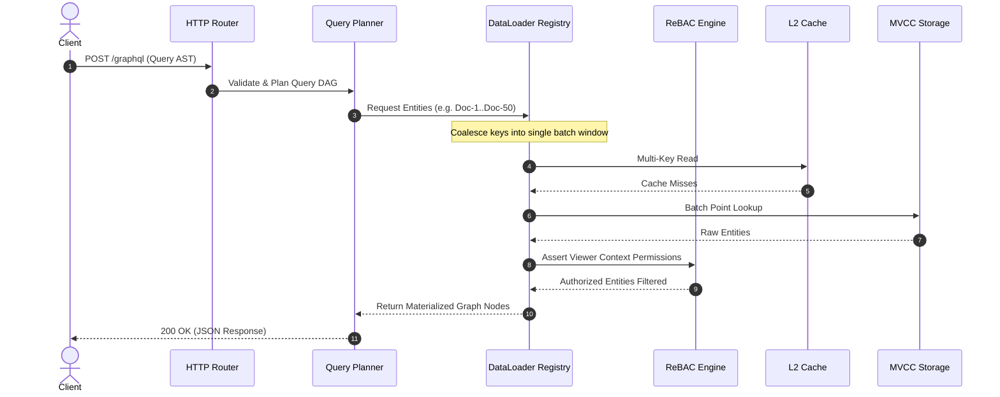

# Axon Architecture Specification

Axon is an asynchronous federated graph execution engine, relationship-based access control (ReBAC) hypervisor, and object-graph data fabric built in Hack.

This document details the internal architecture, subsystem boundaries, data flows, and memory layouts of the Axon kernel.

---

## 1. High-Level System Architecture

Axon coordinates distributed object-graph queries and mutations across heterogenous storage tiers and federated subgraphs while enforcing strict relationship-based authorization policies at every node traversal.

```
+-----------------------------------------------------------------------+
|                            Network Ingress                            |
|             HTTP/1.1 Radix Router | GraphQL-over-HTTP API             |
+-----------------------------------+-----------------------------------+
                                    |
                                    v
+-----------------------------------------------------------------------+
|                            Query Subsystem                            |
|     Lexer & Parser -> AST -> Validator -> Cost Estimator & Planner    |
+-----------------------------------+-----------------------------------+
                                    |
                 +------------------+------------------+
                 |                                     |
                 v                                     v
+---------------------------------+   +---------------------------------+
|      ReBAC Hypervisor Core      |   |       DataLoader Subsystem      |
|  Zanzibar Relation Engine       |   |  Request-Scoped Memoization     |
|  Cycle-Memoized Check Algorithm |   |  Microtask Queue Coalescing     |
|  Userset Rewrite Optimizer      |   |  Batch Entity / Edge Resolvers  |
+----------------+----------------+   +----------------+----------------+
                 |                                     |
                 +------------------+------------------+
                                    |
                                    v
+-----------------------------------------------------------------------+
|                         Multi-Tier Cache Fabric                       |
|   L1 Request Cache | L2 Shared LRU / ARC / 2Q | Invalidation Bus      |
+-----------------------------------+-----------------------------------+
                                    |
                 +------------------+------------------+
                 |                                     |
                 v                                     v
+---------------------------------+   +---------------------------------+
|       Storage & Durability      |   |      Federation & Mesh          |
|  In-Memory MVCC Storage Engine  |   |  Supergraph Schema Stitching    |
|  Append-Only Binary WAL         |   |  Sub-query Decomposition        |
|  LSM Tree & SSTable Compaction  |   |  Circuit Breaker & Fallback     |
+---------------------------------+   +---------------------------------+
```

---

## 2. Asynchronous Execution and Microtask Coalescing

To eliminate the $O(N)$ round-trip penalty (the classic N+1 query problem) inherent in deeply nested graph traversals, Axon uses a cooperative microtask scheduler.

When an operation requests an entity or association edge:
1. The resolver enqueues the target key into an `AsyncBatcher` rather than immediately executing an I/O query.
2. The query executor advances to sibling fields at the current tree depth, enqueuing additional keys.
3. Upon yielding the execution turn, the `DataLoaderRegistry` dispatches all accumulated keys in a single bulk operation.
4. Resolved entities are placed into the request-scoped cache and returned to the waiting deferred tokens.



---

## 3. Zanzibar Relationship-Based Access Control (ReBAC)

Axon implements a fine-grained authorization model inspired by Google Zanzibar. Access rights are determined by reachability over directed relationship graphs:

$$\text{Allow}(u, R, O) \iff u \in \text{Userset}(O, R)$$

### 3.1 Userset Rewrite Operators
Each relation is defined by a rewrite rule composed of primitive algebraic set operations:
- `this`: Direct tuple matching in the relation store.
- `computed_userset`: Look up another relation on the same object.
- `tuple_to_userset`: Traverse an association edge (tupleset) to find target objects, then evaluate a computed userset on those targets.
- `union`: Disjunction (OR) of child rules.
- `intersection`: Conjunction (AND) of child rules.
- `exclusion`: Set difference ($A \setminus B$).

### 3.2 Cycle Detection Invariant
Because userset rewrites can express mutual group containment (e.g., group A includes group B, and group B includes group A), the `CheckEngine` maintains an explicit evaluation path state set:

$$S = \{ (o, r, s) \mid \text{state currently being evaluated along active call chain} \}$$

If $(o, r, s) \in S$, evaluation terminates along that branch and yields `false`, preventing unbounded recursion without requiring distributed locks.

---

## 4. Multi-Tier Cache Topology

Axon separates caching into distinct isolation boundaries:

1. **L1 Request Cache**:
   - Scope: Lifetime of a single HTTP or GraphQL query.
   - Mechanism: Pointer-direct hash map.
   - Invalidation: Automatic on request completion.

2. **L2 Shared Process Cache**:
   - Scope: Shared across all concurrent worker threads.
   - Policies:
     - `LRUCache`: $O(1)$ recency tracking via hash table + doubly linked list.
     - `ARCCache`: Adaptive Replacement Cache dynamically balancing recency ($T_1$) and frequency ($T_2$).
     - `TwoQueueCache`: 2Q scan-resistant caching using dual FIFO buffers and an LRU promotions queue.
   - Invalidation: Event-driven via `InvalidationBus` publishing on entity write operations.

---

## 5. Persistence, WAL, and MVCC

The durability subsystem ensures durability and point-in-time recovery:
- **Write-Ahead Log (WAL)**: Every state mutation (`PUT`, `DELETE`) is appended to a 64 MB segment file. Each log record is framed with a 64-bit monotonic Log Sequence Number (LSN), timestamp, operation code, table name, record identifier, payload, and a trailing IEEE 802.3 CRC32 checksum.
- **Torn-Write Protection**: During crash recovery, log scanning verifies the CRC32 checksum of every record. The first frame with an invalid checksum or partial write marks the recovery boundary, preventing database corruption.
- **Compaction**: Periodically, the active state is captured as a serialized snapshot, allowing old WAL segments to be truncated.
